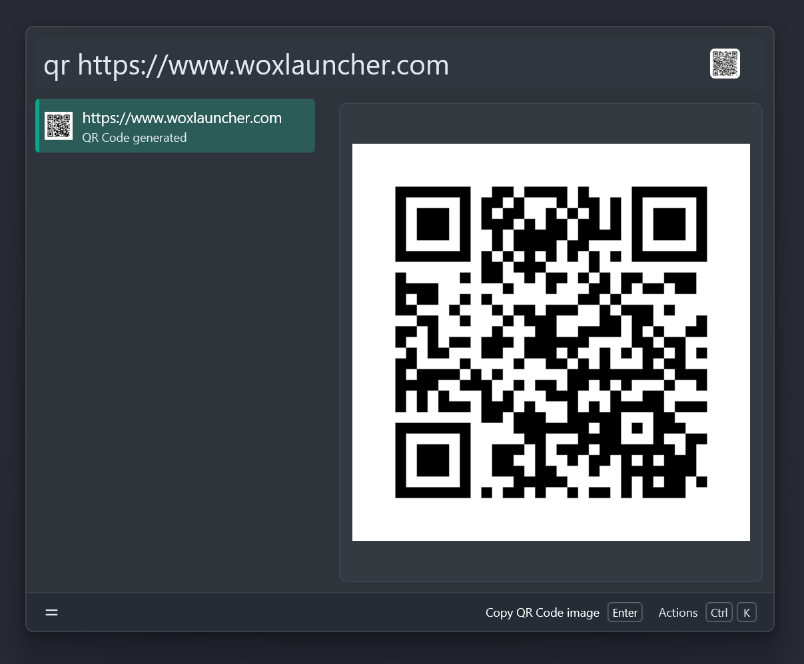
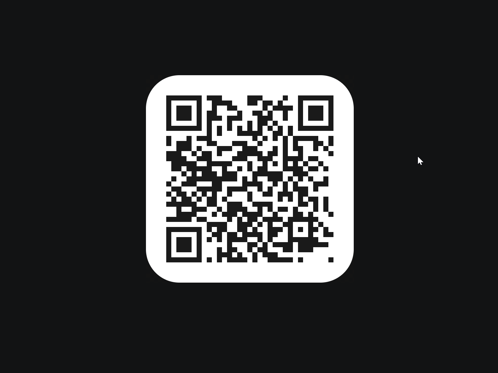

# QRCode


A [Wox](https://www.woxlauncher.com/) plugin that generates a QR Code from text and scans a QR Code from a
screenshot. Everything runs locally, no network access required.

## Features

- **Generate** — `qr <text>` renders a QR Code instantly, with an inline image
  preview and actions to copy the image, copy the text, or save a PNG to the
  Desktop.
- **Scan** — `qr` with no text (or `qr scan`) starts a screenshot, lets you pick a
  screen region, and decodes every QR Code / barcode in it with
  [zxing-cpp](https://github.com/zxing-cpp/zxing-cpp). Results can be copied, and
  URLs can be opened in the browser in one keystroke.
- **Localized** — English and Simplified Chinese, following the Wox language.

## Screenshot





## Install

```shell
wpm install QRCode
```

## Usage

### Generate a QR Code

```shell
qr https://example.com
```

Type the trigger keyword `qr` followed by the text to encode. The result icon
*is* the QR Code, and the preview pane shows it full size.

The trigger keyword is editable in the Wox plugin settings; any keyword works,
because the mode is picked from the query itself, never from the keyword text.

| Action | Description |
| --- | --- |
| Copy QR Code image | Put the QR Code on the clipboard as an image |
| Copy text | Copy the encoded text |
| Save PNG to Desktop | Write `qrcode_<timestamp>.png` to the Desktop |

### Scan a QR Code from the screen

```shell
qr scan
```

Or type the trigger keyword `qr` followed by a space and nothing else: Wox shows
the scan entry, and `Enter` starts the screenshot. Drag to select the region
containing the QR Code; recognition runs automatically once the selection is
confirmed.

> Scan never depends on a specific trigger keyword, so renaming `qr` in the
> plugin settings cannot hide it. `qrs` was removed in 1.1.0 — use `qr scan`
> (or the empty `qr ` query) instead.

> **macOS:** scanning requires Wox to have the **Screen Recording** permission.
> Open *System Settings → Privacy & Security → Screen Recording* and enable Wox.

| Action | Description |
| --- | --- |
| Start screenshot scan | Take a new screenshot and scan it |
| Copy scan result | Copy a decoded payload |
| Open in browser | Shown only when the payload is an `http`/`https` URL |

## Requirements

- Wox >= 2.0.0
- Windows, Linux, or macOS (on macOS, Wox needs **Screen Recording** permission for `qr scan`)

The Python runtime dependencies (`qrcode`, `pypng`, `zxing-cpp`) are bundled in
the released package for Python 3.10–3.15, so nothing needs to be installed by
hand.

On macOS, grant Wox the **Screen Recording** permission before using `qr scan`
(see [Scan a QR Code from the screen](#scan-a-qr-code-from-the-screen)).

## Development

```shell
make install   # install dependencies (uv sync --all-extras)
make lint      # ruff check + mypy
make format    # ruff format
make test      # run unit tests
make build     # build the plugin into dist/
make package   # package dist/ into wox.plugin.qrcode.wox
```

### Project structure

```shell
src/qrcode_main.py   Plugin implementation (query handling + actions)
plugin.json          Plugin metadata and i18n strings
tests/               Unit tests
scripts/             Project template initialization script
```

## License

GPL-3.0 — see [LICENSE](LICENSE).
